# Time AI · Krea 2 Anime Prompt Director


[](README.md)
[](README.zh-CN.md)
[](https://shiguanggougouo.github.io/krea2-anime-prompt-director/)
[](https://www.bilibili.com/video/BV1neJf6XEdA/?t=728&vd_source=a7826b5703f20f1ca10cf2ddd4fba044)

A reusable agent skill that turns a short Chinese or English idea into a **complete, Krea 2-ready anime prompt** — with a faithful Chinese translation alongside it.

It does five things a generic "prompt enhancer" does not:

1. **Anchors character identity in visible evidence** — hair shape and arrangement, eyes and markings, silhouette, signature costume layers, colors and materials, props — selected for the framing you asked for.
2. **Rebuilds locations instead of naming them** — "World Martial Arts Tournament" becomes a raised pale-stone ring with a red boundary line, crowded stepped stands, painted posts, banners and a tiled entrance pavilion.
3. **Automatically fills an unspecified environment** — if you only give a character name, it picks a story-rich classic setting from that character's own anime, manga or game canon and describes the actual scenery.
4. **Keeps repeat requests distinct** — when the same character comes back in a conversation, both the setting/story beat and the action change.
5. **Stages action and interaction** — one decisive instant with intent, weight, direction of force and a visible consequence in the scene; with several characters, a readable exchange of who initiates, who responds, and where eyelines and contact land. Never "dynamic pose" or "fighting pose."

It is grounded in the two official Krea anime guides plus an evidence-aware workflow for the community Krea2 Character Catalog.

▶ **Video walkthrough (Bilibili, Chinese):** [installing and using this skill — 12:08](https://www.bilibili.com/video/BV1neJf6XEdA/?t=728&vd_source=a7826b5703f20f1ca10cf2ddd4fba044) · [the anime character reference tool the 24 cases were cast with — 09:38](https://www.bilibili.com/video/BV1neJf6XEdA/?t=578&vd_source=a7826b5703f20f1ca10cf2ddd4fba044)

---

## Quick start

### Install

Drop the whole folder into the skills directory your agent reads. Keep `SKILL.md` and `references/` together — the references are loaded on demand, so do not split them up.

```bash
# Codex / repo-local
git clone https://github.com/shiguanggougouo/krea2-anime-prompt-director.git .agents/skills/krea2-anime-prompt-director

# WorkBuddy / Claude-style user-level
git clone https://github.com/shiguanggougouo/krea2-anime-prompt-director.git ~/.workbuddy/skills/krea2-anime-prompt-director
```

### Use

Just describe what you want and let the skill do the work:

```
用 krea2-anime-prompt-director 扩写：海绵宝宝和派大星
```

```
Use krea2-anime-prompt-director: Sailor Moon, classic moonlit scene
```

```
用 krea2-anime-prompt-director：京都动画风格，雨后的日本高中教室，不要人物
```

### Output

Only two sections — nothing else, no process notes:

```
POSITIVE:
Anime-style illustration of SpongeBob SquarePants and Patrick Star from SpongeBob SquarePants,
jellyfishing together in Jellyfish Fields. SpongeBob, a bright yellow square sponge with large blue
eyes, wears his white shirt, red tie, brown square pants, knee-high socks, and shiny black shoes.
He leans forward with a jellyfishing net raised, delighted as a glowing pink jellyfish drifts just
within reach...

中文对照：
《海绵宝宝》的海绵宝宝和派大星在水母田里一起捕捉水母。海绵宝宝是一块亮黄色的方形海绵，有一双
大大的蓝眼睛，穿着白衬衫、红领带、棕色方裤、及膝袜和擦得发亮的黑皮鞋。他兴奋地向前倾身，举起
捕网，正要接住一只漂到网边的粉色发光水母……
```

---

## 24 cases, start to finish

Every card below is a real run. The line under each image is exactly what was typed — nothing else was added.

<table role="presentation">
<tr><td align="center" valign="top" width="33%"><a href="docs/gallery/01.webp">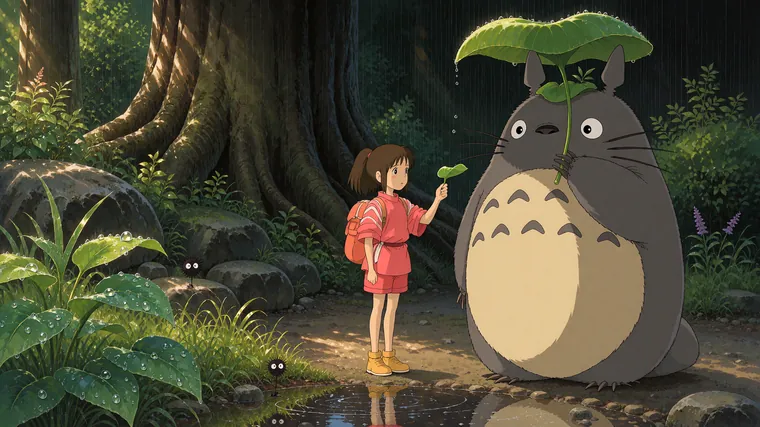</a><br><b>Spirited Away · Chihiro &amp; Totoro · forest after the rain</b><br><sub>input: 千与千寻动漫里的千寻和龙猫.</sub></td><td align="center" valign="top" width="33%"><a href="docs/gallery/11.webp">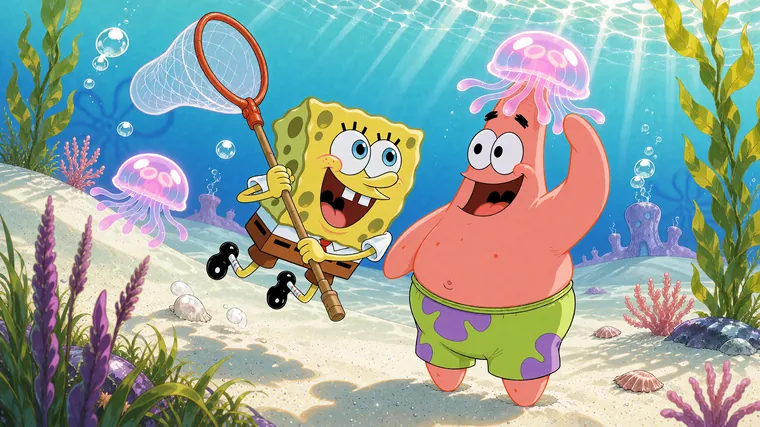</a><br><b>SpongeBob SquarePants · SpongeBob &amp; Patrick · Jellyfish Fields</b><br><sub>input: 海绵宝宝和派大星</sub></td><td align="center" valign="top" width="33%"><a href="docs/gallery/12.webp">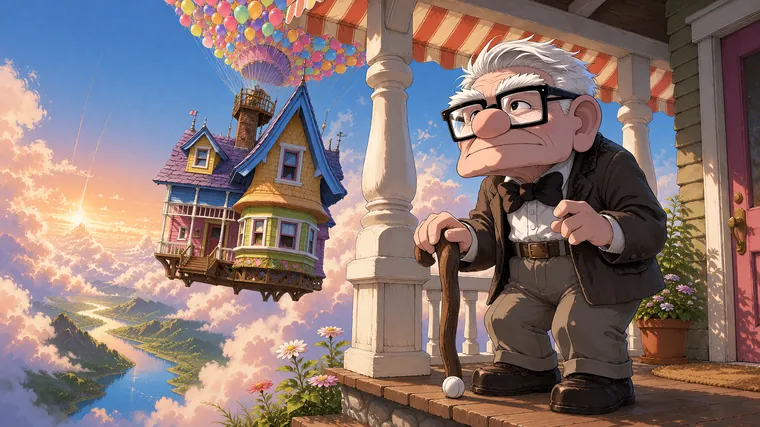</a><br><b>Up · Carl · the porch above the clouds</b><br><sub>input: Carl Fredricksen from Up.</sub></td></tr>
<tr><td align="center" valign="top" width="33%"><a href="docs/gallery/09.webp">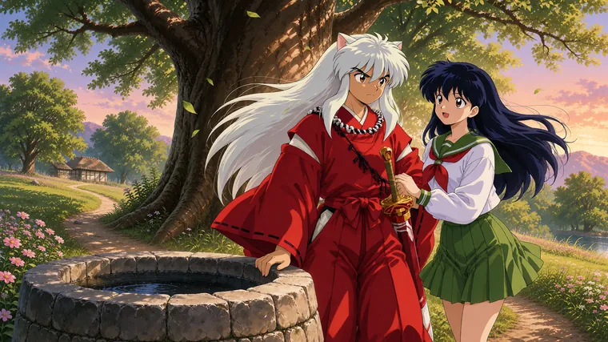</a><br><b>Inuyasha · Inuyasha &amp; Kagome · beneath the sacred tree</b><br><sub>input: 犬夜叉和戈薇</sub></td><td align="center" valign="top" width="33%"><a href="docs/gallery/19.webp">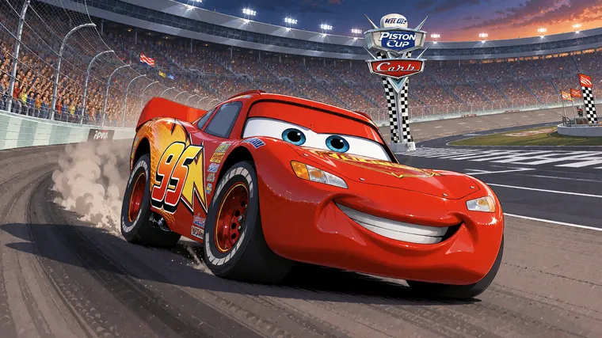</a><br><b>Cars · Lightning McQueen · the final turn</b><br><sub>input: lightning mcqueen from cars (m…</sub></td><td align="center" valign="top" width="33%"><a href="docs/gallery/17.webp">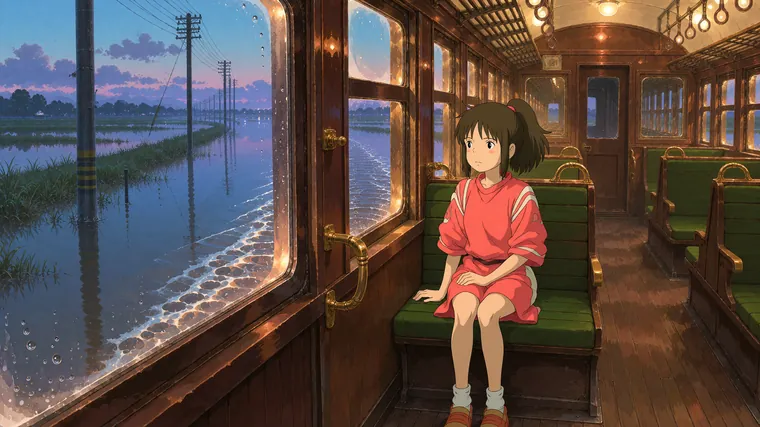</a><br><b>Spirited Away · Chihiro · the sea railway</b><br><sub>input: 千与千寻里的千寻，火车</sub></td></tr>
<tr><td align="center" valign="top" width="33%"><a href="docs/gallery/15.webp">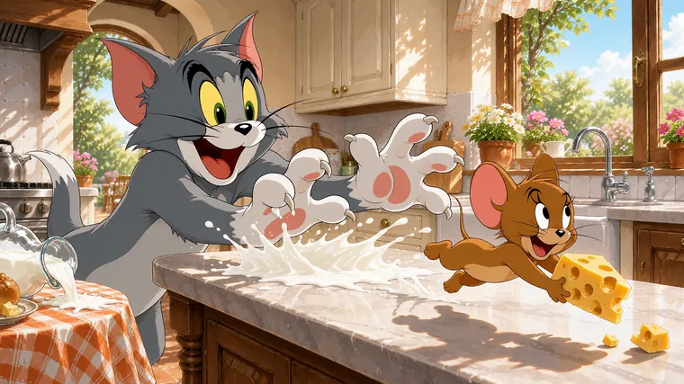</a><br><b>Tom and Jerry · Tom &amp; Jerry · kitchen chase</b><br><sub>input: 猫和老鼠动漫里的猫和老鼠</sub></td><td align="center" valign="top" width="33%"><a href="docs/gallery/18.webp">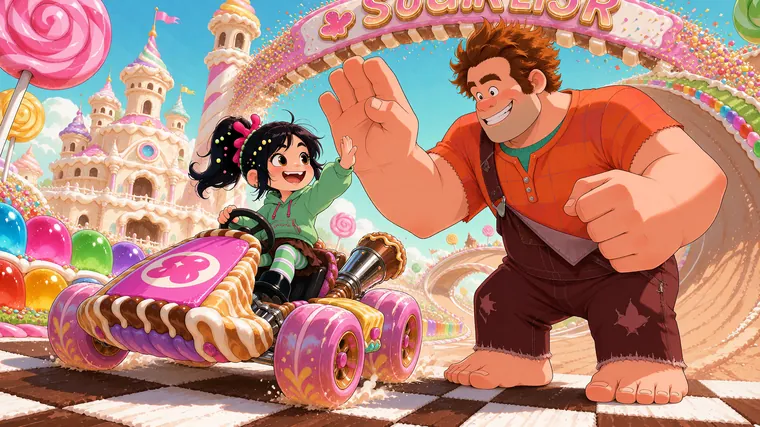</a><br><b>Wreck-It Ralph · Ralph &amp; Vanellope · the finish line</b><br><sub>input: 无敌破坏王里的男主和女主</sub></td><td align="center" valign="top" width="33%"><a href="docs/gallery/13.webp">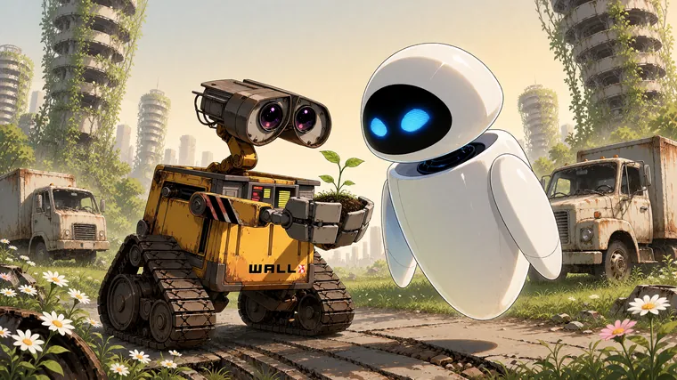</a><br><b>WALL-E · WALL-E &amp; EVE · the seedling</b><br><sub>input: 机器人总动员里的男主和女主</sub></td></tr>
<tr><td align="center" valign="top" width="33%"><a href="docs/gallery/24.webp">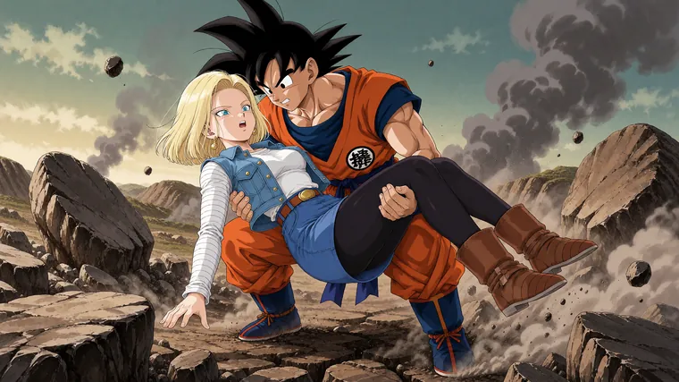</a><br><b>Dragon Ball · Goku catches Android 18</b><br><sub>input: 龙珠里孙悟空救下了18号，抱着她</sub></td><td align="center" valign="top" width="33%"><a href="docs/gallery/23.webp">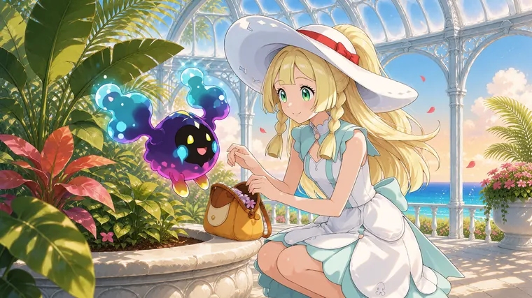</a><br><b>Pokémon Sun &amp; Moon · Lillie · Aether Paradise</b><br><sub>input: lillie (pokemon), pokemon, 1gi…</sub></td><td align="center" valign="top" width="33%"><a href="docs/gallery/10.webp">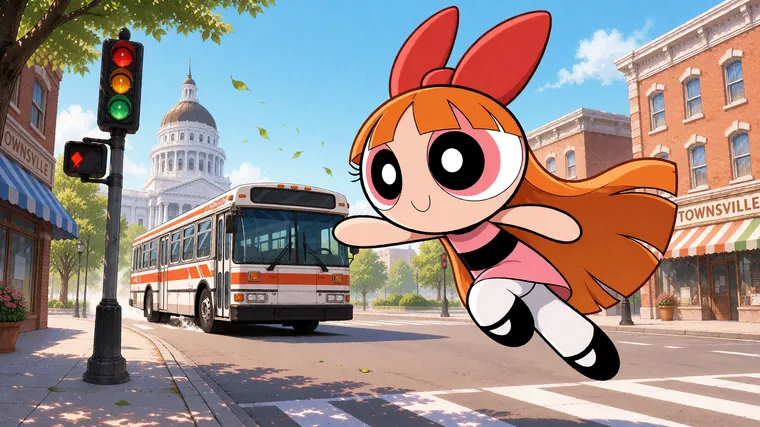</a><br><b>The Powerpuff Girls · Blossom · the runaway bus</b><br><sub>input: blossom (ppg) from powerpuff g…</sub></td></tr>
<tr><td align="center" valign="top" width="33%"><a href="docs/gallery/02.webp">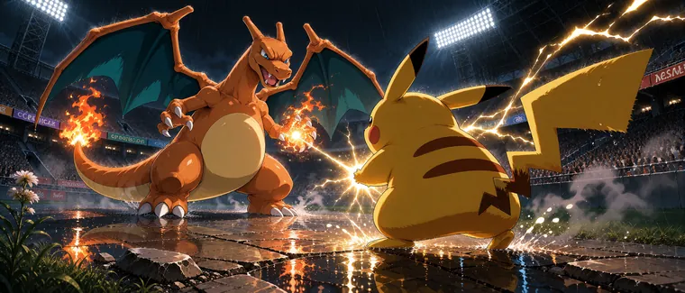</a><br><b>Pokémon · Charizard vs Pikachu · rain-soaked final</b><br><sub>input: A non-human character. Appeara…</sub></td><td align="center" valign="top" width="33%"><a href="docs/gallery/07.webp">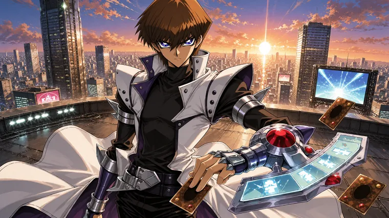</a><br><b>Yu-Gi-Oh! · Kaiba · Battle City rooftop</b><br><sub>input: kaiba seto from yu-gi-oh!. A m…</sub></td><td align="center" valign="top" width="33%"><a href="docs/gallery/04.webp">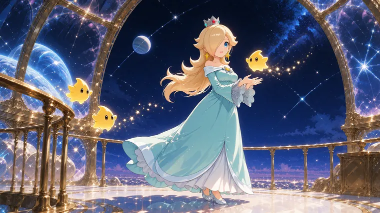</a><br><b>Super Mario · Rosalina · Comet Observatory</b><br><sub>input: rosalina from mario (series). …</sub></td></tr>
<tr><td align="center" valign="top" width="33%"><a href="docs/gallery/08.webp">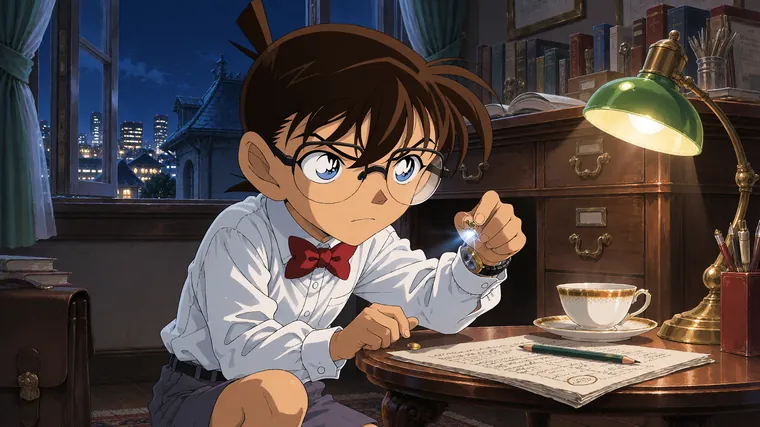</a><br><b>Detective Conan · Conan · the agency after dark</b><br><sub>input: edogawa conan from meitantei c…</sub></td><td align="center" valign="top" width="33%"><a href="docs/gallery/20.webp">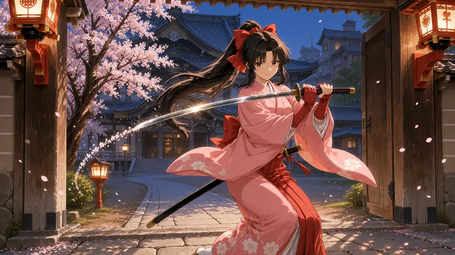</a><br><b>Sakura Wars · Sakura · Imperial Theatre courtyard</b><br><sub>input: shinguuji sakura from sakura t…</sub></td><td align="center" valign="top" width="33%"><a href="docs/gallery/06.webp">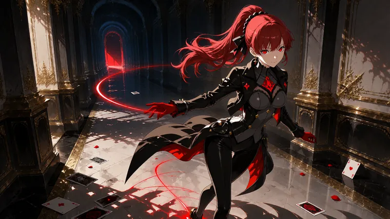</a><br><b>Persona 5 · Kasumi · Palace corridor</b><br><sub>input: yoshizawa kasumi from persona.…</sub></td></tr>
<tr><td align="center" valign="top" width="33%"><a href="docs/gallery/03.webp">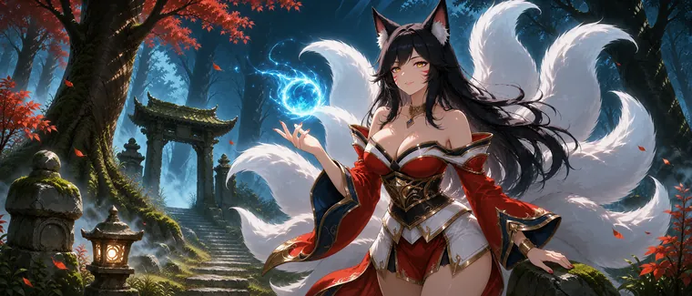</a><br><b>League of Legends · Ahri · Ionian moonlight</b><br><sub>input: ahri (league of legends) from …</sub></td><td align="center" valign="top" width="33%"><a href="docs/gallery/21.webp">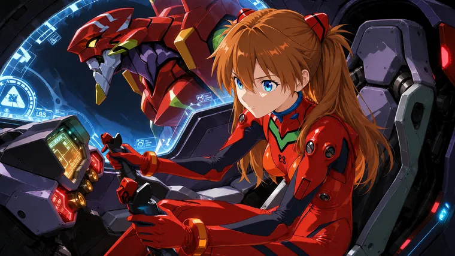</a><br><b>Neon Genesis Evangelion · Asuka · the entry plug</b><br><sub>input: souryuu asuka langley from neo…</sub></td><td align="center" valign="top" width="33%"><a href="docs/gallery/22.webp">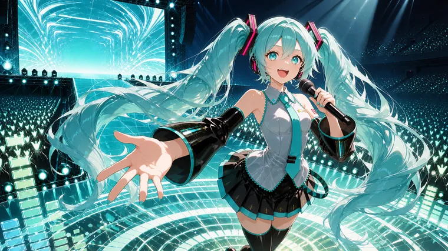</a><br><b>VOCALOID · Hatsune Miku · holographic stage</b><br><sub>input: 初音未来，Vocaloid, 1girl, 水蓝色的眼睛, …</sub></td></tr>
<tr><td align="center" valign="top" width="33%"><a href="docs/gallery/05.webp">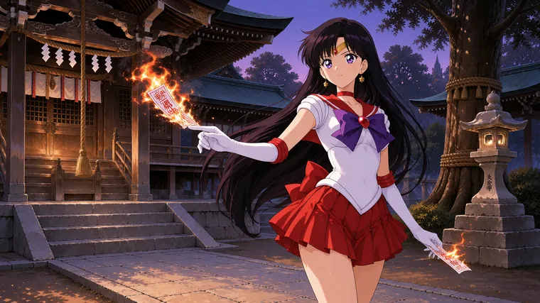</a><br><b>Sailor Moon · Sailor Mars · shrine at dusk</b><br><sub>input: sailor mars from bishoujo sens…</sub></td><td align="center" valign="top" width="33%"><a href="docs/gallery/14.webp">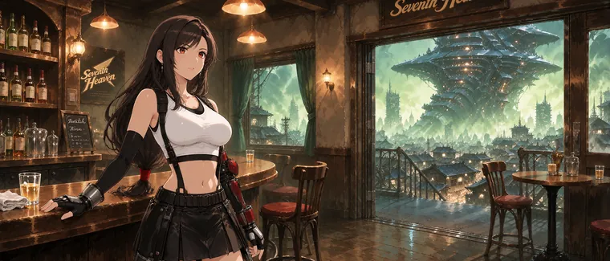</a><br><b>Final Fantasy VII · Tifa · Seventh Heaven after closing</b><br><sub>input: tifa lockhart from final fanta…</sub></td><td align="center" valign="top" width="33%"><a href="docs/gallery/16.webp">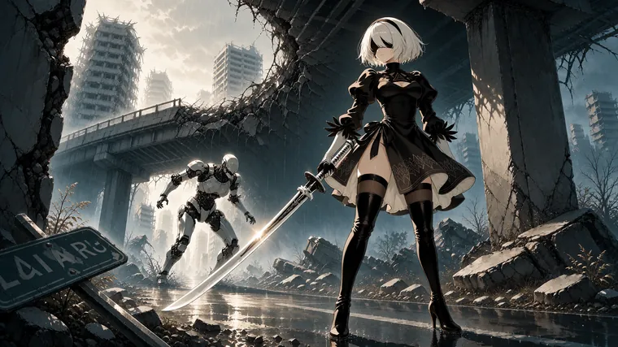</a><br><b>NieR:Automata · 2B · rain-darkened ruins</b><br><sub>input: machine (nier) from nier:autom…</sub></td></tr>
</table>

Full resolution in [`docs/gallery/`](docs/gallery/) (1600px / 760px / 440px) ·
browse them one by one on the [online gallery](https://shiguanggougouo.github.io/krea2-anime-prompt-director/#gallery).

---

## What makes it different

| Generic prompt helper | This skill |
|---|---|
| Stacks Danbooru tags and quality macros (`masterpiece`, `8k`, `best quality`) | Writes connected natural-language prose — tags only if you explicitly ask for a tag list |
| Leaves the background as "in a room" or "outdoors" | Picks a canon setting and describes architecture, materials, scale, light and weather |
| Writes "at the World Martial Arts Tournament" and expects the model to know it | Converts the proper noun into a drawable physical layout with recognizable identifiers |
| Reuses one default outfit for every scene | Resolves the character's **story-moment version** first — arc, location, role, transformation |
| Same character, same pose, same place every time | Tracks used scene/action pairs and varies both on repeat requests |
| "Dynamic pose", "fighting pose", figures lined up side by side | One drawable instant with body mechanics, force direction, environment response — and for groups, a real exchange with distinct roles and reactions |
| Claims "I checked the catalog" | Only claims a catalog lookup if an entry was genuinely inspected |

---

## Changelog

Version history lives in [CHANGELOG.md](CHANGELOG.md) — 1.0.0 through 1.6.0, each entry describing the generation problem it fixed.

## Files

| File | What it holds |
|---|---|
| `SKILL.md` | Core behavior, workflow, and required output format |
| `references/action-direction.md` | Action staging and character interaction: one decisive instant, body mechanics, environment response, multi-character exchange |
| `references/style-language.md` | Style-selection matrix, scene-design language bank, prompt scaffolds |
| `references/examples.md` | Full EN/CN examples — character scenes, action, environment-only, variant selection |
| `references/catalog-workflow.md` | How to use Krea2 Character Catalog entries without overstating reliability |
| `references/source-notes.md` | Source URLs, source-derived findings, verification boundaries |
| `docs/index.html` | Project landing page (GitHub Pages source, Chinese/English toggle) |
| `docs/cases.js` | Data for the 24-case gallery — each input, the prompt returned, and bilingual captions |
| `docs/gallery/` | 24 rendered results (`1600px` full, `760px` thumbs, `440px` strips) |
| `CHANGELOG.md` | Version history from 1.0.0 to 1.6.0 |
| `README.zh-CN.md` | Chinese edition of this README |

## Built-in style anchors

One dominant anchor per prompt, at most one bounded twist:

- Studio Ghibli aesthetic — hand-painted watercolor, restrained natural palette
- Makoto Shinkai / CoMix Wave Films — hyper-saturated sky, cloud edges, urban light
- Kyoto Animation — warm window light, delicate linework, lived-in detail
- Madhouse / urban-noir — cool blue-green, wet asphalt, sodium-yellow accents
- 1990s Sunrise / classic OVA mecha — hard-edged cel shading, industrial backgrounds
- Shoujo register / Seinen register
- Classic battle-shonen cel-animation

## Honest limits

- The skill does **not** bundle the Krea2 Character Catalog dataset and does not claim to query it automatically. It uses an accessible entry, export or provided file when one is there, and continues honestly when it is not.
- Catalog entries are **provisional**. A match is useful evidence, not proof of canon and definitely not proof that a character exists in Krea 2's training data.
- Prompt text alone cannot guarantee perfect character continuity across a series. For that, use a Krea 2 style reference or a mood board of roughly 20–40 frames.

## Sources

- [Anime Backgrounds with Krea 2](https://www.krea.ai/blog/anime-backgrounds-with-krea-2) — Krea official
- [Studio Anime Aesthetics with Krea 2](https://www.krea.ai/blog/studio-anime-aesthetics-with-krea-2) — Krea official
- [Krea2 Character Catalog](https://github.com/ukr8b3g-cmyk/Krea2-Character-Catalog) — community project
- [Agent Skills format](https://developers.openai.com/api/docs/guides/tools-skills) — OpenAI

## License

MIT — see [LICENSE](LICENSE).
